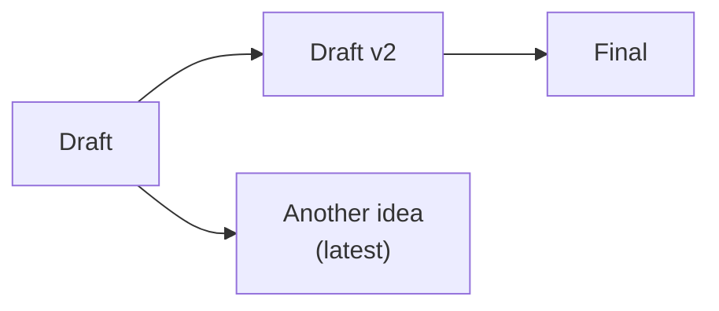
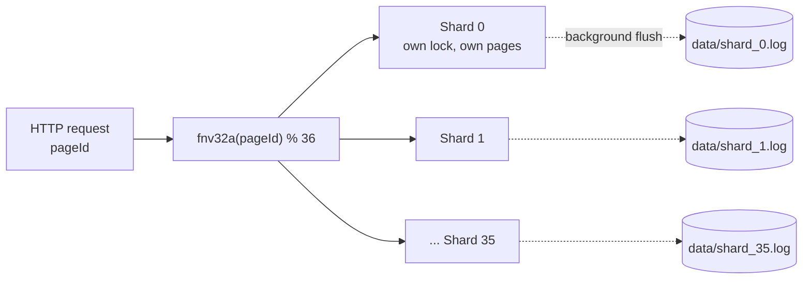

# L-36

**Git-style history for JSON documents, in one small Go server.**

Save every edit. Jump back to any version. Branch from the past without losing the future. All over plain HTTP, with no database to run.

[](https://github.com/DenQ/L36/actions/workflows/go.yml)
[](https://go.dev)
[](https://github.com/DenQ/L36)
[](LICENSE)

- **20,000+ versioned writes per second** over HTTP, each one a real diff.
- **The current version is always in memory.** Reading it never walks the history.
- **Any old version is at most 9 patches away**, whether the page has 20 versions or 20,000.
- **Branches come built in.** Move the head back, keep writing, and both timelines stay readable.
- **One binary, 36 log files, three dependencies.** Nothing else to deploy.

## See it in 60 seconds

Start the server:

```bash
git clone https://github.com/DenQ/L36.git && cd L36
cp example-env .env
make install && make run
```

In another terminal, write a short history, rewind it, and branch. The demo uses [`jq`](https://jqlang.org) to grab the first version ID.

```bash
# Create a page. Its first version is the root of the tree.
V1=$(curl -s -X POST localhost:1236/api/pages \
  -d '{"pageId":"doc","content":{"title":"Draft"},"userId":"alice"}' | jq -r '.versions[0].versionId')

# Two edits.
curl -s -X POST localhost:1236/api/pages/doc/versions -d '{"content":{"title":"Draft v2"},"userId":"alice"}'
curl -s -X POST localhost:1236/api/pages/doc/versions -d '{"content":{"title":"Final"},"userId":"alice"}'

# Changed your mind? Move the head back to the first draft and write from there.
curl -s -X POST localhost:1236/api/pages/doc/versions/$V1/latest
curl -s -X POST localhost:1236/api/pages/doc/versions -d '{"content":{"title":"Another idea"},"userId":"alice"}'

# The whole tree. Nothing was overwritten.
curl -s localhost:1236/api/pages/doc/versions | jq
```

The page now looks like this, and every node can still be read:



## Good fit for

- **Undo and redo** in editors, whiteboards, and form builders, where an undo followed by a new edit opens a new branch instead of destroying the old one.
- **Drafts and revisions** of CMS pages, documents, and templates.
- **Config and state snapshots**, such as feature flags, game maps, and workflow definitions, where you need to answer "what did this look like on Tuesday?"

## How it works

### Sharding: pages never wait on each other



A `pageId` always hashes to the same one of 36 shards. Each shard has its own mutex, its own in-memory pages, and its own append-only log file. There is no global lock, so writes to pages on different shards never contend.

### Storage: full text where it pays, diffs everywhere else

Each version keeps either its full text (a snapshot) or a reverse patch against its child. Snapshots sit on the root, on every 10th version down a path, and on every leaf.

```text
depth:   0    1 … 9    10   11 … 19   20   21 … 23   24
        [S] ← p … p ← [S] ← p … p ← [S] ← p … p ← [S]  latest
         S = full text   p = reverse patch (github.com/sergi/go-diff)
```

- **Reading the latest version** returns the leaf, which is already in memory.
- **Reading an older version** starts at the nearest snapshot below it and applies at most 9 reverse patches.
- **Memory stays bounded.** Only the hot tail of each page, meaning the latest version and its path back to the nearest snapshot, stays in RAM. Older bodies are read back from the shard log when someone asks for them.
- **Disk stays small.** When ten versions on a shard still store full text they no longer need, the shard rewrites its log to keep only snapshots and patches.

### Durability: fast writes, explicit tradeoff

A write is acknowledged as soon as it is in memory. Each shard appends its pending changes to its log in the background, every `SAVE_INTERVAL_SECONDS` (1 second in `example-env`, 1 minute if the variable is unset).

- **Graceful stop** (`Ctrl+C` or `SIGTERM`) finishes in-flight requests and flushes every shard before exit.
- **Hard crash** (`kill -9`, power loss) can lose writes from the last flush interval. On the next start, a half-written record at the end of a log is cut off, so the rest of the shard loads cleanly.

If you cannot afford to lose that window, set `SAVE_INTERVAL_SECONDS` low, or put L-36 behind something that retries.

## Performance

Measured with `make stress` on GitHub Actions (`ubuntu-latest`), 100 concurrent clients:

| Workload | Throughput |
| :--- | ---: |
| Versioned writes, each one a real diff | **20,400+ RPS** |
| Page writes (create, or find it already exists) | **63,900+ RPS** |

Versioned writes are the number that matters. Each request creates a page or appends a version whose content actually changed, so it pays for diffing and snapshot bookkeeping. Across 36 shards that is about 550 version saves per second per shard. The page-write number is the light path, where most calls find the page already there and return immediately.

The stress test runs the full HTTP router and storage engine in-process over loopback (`httptest`). It does not include the background log flush, which runs off the request path. Each local run is appended to `tests/stress/history.jsonl` with the commit, Go version, and CPU count, so you can track regressions on your own machine.

`make load` is the other number. It builds `bin/l36`, starts that binary, and runs [vegeta](https://github.com/tsenart/vegeta) against it for 10 seconds per scenario with 100 workers. The shard log flushes every second, so disk is on the path. On a 16-core Mac (`darwin/amd64`, Go 1.25):

| Workload | Throughput | p99 |
| :--- | ---: | ---: |
| Page writes, mostly `409` once the page exists | **37,300 RPS** | 5.7 ms |
| Versioned writes, about 2,000 versions on each of 100 pages | **20,500 RPS** | 45 ms |

The same machine's in-process `make stress`, which stops at 50 versions per page and does not flush, did 36,200 page RPS and 19,600 version RPS. The binary with a long history and a live flush stays in that band. Each `make load` appends a line to `load/history.jsonl`.

## HTTP API

| Method | Path | Does | Returns |
| :--- | :--- | :--- | :--- |
| `POST` | `/api/pages` | Create a page with its first version | `201` page, `409` exists, `400` empty `pageId`, or empty or too long `userId` |
| `POST` | `/api/pages/{pageId}/versions` | Append a version under the head | `201` version, `404` no page, `400` empty or too long `userId` |
| `GET` | `/api/pages/{pageId}/versions/latest` | Read the head | `200` version |
| `GET` | `/api/pages/{pageId}/versions/{versionId}` | Read any version | `200` version, `404` |
| `GET` | `/api/pages/{pageId}/versions` | List the tree, without bodies | `200` list |
| `POST` | `/api/pages/{pageId}/versions/{versionId}/latest` | Move the head, so the next write branches from here | `200` version, `404` |
| `DELETE` | `/api/pages/{pageId}` | Delete a page and its history | `204`, `404` |

Request bodies are JSON: `{"pageId": "...", "content": ..., "userId": "..."}` to create a page, and `{"content": ..., "userId": "..."}` to append a version. `content` can be a string or any JSON value. `userId` is the author of that version: a required string of at most 256 bytes. An empty or longer value is `400`. Delete and moving the head do not take a `userId`; the node keeps the author of the write that created it.

Objects and arrays are stored as JSON text, and they come back as a string:

```json
{
  "versionId": "d756298a-8788-4cf0-b1ac-20c076b01be8",
  "parentId": "c8d0c5c2-13dd-46ee-a7fd-a0d0434e037e",
  "content": "{\"title\":\"Another idea\"}",
  "dt": 1794234088,
  "userId": "alice",
  "latest": true
}
```

The tree list returns `versionId`, `parentId`, `dt` (Unix seconds), `userId`, and `latest` for each node. Build the tree from `parentId`. The root has no `parentId`.

## Tools

Fill the server with demo data: three pages per shard with 50, 100, and 150 versions. The server must be running. Set `L36_URL` to target a server other than `http://127.0.0.1:1236`.

```bash
make seed
```

Load-test the binary with [vegeta](https://github.com/tsenart/vegeta). Install it once, then run the harness from this repo. It builds `bin/l36`, listens on port `12360`, and writes shards to a temporary directory, so a server you already have on `1236` is left alone.

```bash
brew install vegeta
make load
```

Two scenarios, 10 seconds each, 100 workers, flush every second. Pages cycle 36 ids, so most responses are `409` and still count toward RPS. Versions append a new body to 100 pages and should be `201`. RPS, the 2xx ratio, and p99 are printed and appended to `load/history.jsonl`.

```bash
go run ./load -duration 3s          # shorter run
go run ./load -save-interval 60     # flush stays off for the whole run
```

Print one shard's pages as version trees, straight from its log file:

```bash
make view N=0
```

## Configuration

| Variable | Default | Meaning |
| :--- | :--- | :--- |
| `PORT` | `1236` | HTTP port |
| `SAVE_INTERVAL_SECONDS` | `60` | How often each shard flushes to its log |

Copy `example-env` to `.env` to set them. Data lives in `data/shard_N.log`.

## Project layout

| Path | Role |
| :--- | :--- |
| `cmd/l36` | Server entry point |
| `cmd/seed` | Demo data over HTTP |
| `cmd/view` | Print one shard as trees |
| `internal/handlers` | HTTP routes |
| `internal/storage` | Shards, diffs, snapshots, shard logs |
| `internal/models` | Page and version types |
| `tests/stress` | In-process throughput tests |
| `load` | Vegeta against the `bin/l36` binary |
| `docs/api-design.txt` | API contract |

## Develop

```bash
make dev     # reload on change (air)
make test    # package tests
make race    # all tests with the race detector
make stress  # in-process throughput
make load    # vegeta against bin/l36
make bench   # storage benchmarks
```

## License

MIT. See [`LICENSE`](LICENSE).

Copyright (c) 2026 Denis Ivanov
